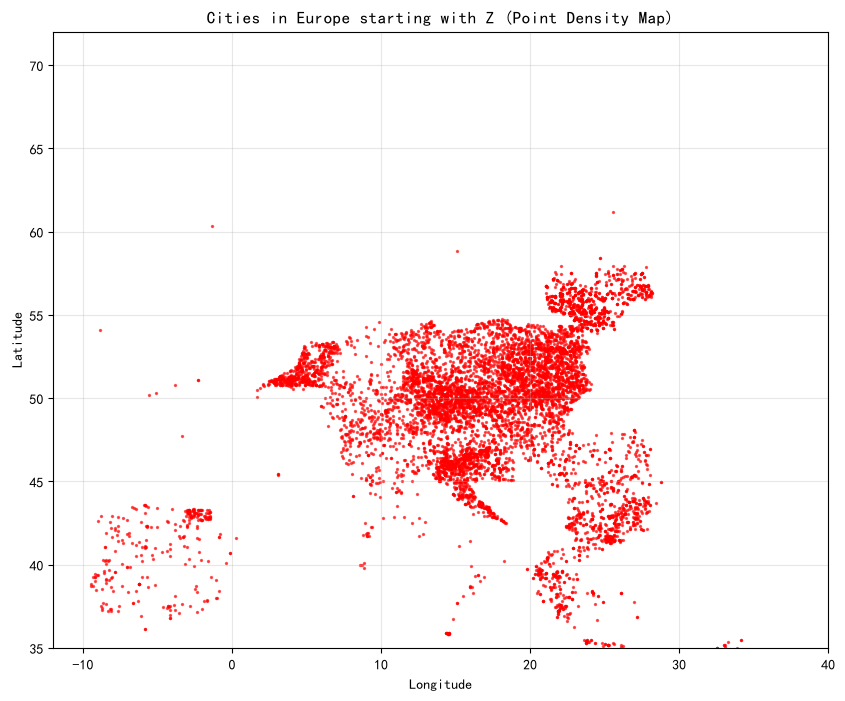
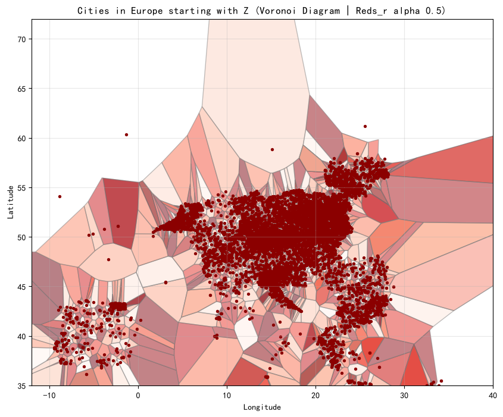

# European City Spatial Analysis Project
## Research Question
How are European cities starting with a selected letter distributed geographically, and what spatial patterns can be observed using Voronoi diagrams?

## Dataset Source
Open geographic dataset of European cities, containing city name, latitude and longitude. The dataset is available for academic non-commercial research.

## Methods and Tools
Python, Pandas, NumPy, Matplotlib, Scipy Spatial, Jupyter Notebook.
Two visualizations are created: point density scatter map and Voronoi polygon map.

## Key Findings and Limitation
**Findings**: Cities starting with Z are concentrated in Central Europe. Voronoi diagram divides the region into zones where each zone is closer to its city than any other city.
**Limitation**: The dataset includes many small villages. This creates heavy clustering in central Europe, and population size is not incorporated into the spatial model.

## Instructions for running the analysis
1. Install required packages:
`pip install -r requirements.txt`
2. Open the `.ipynb` notebook file in Jupyter Lab / Jupyter Notebook
3. Execute all cells sequentially to reproduce maps.
